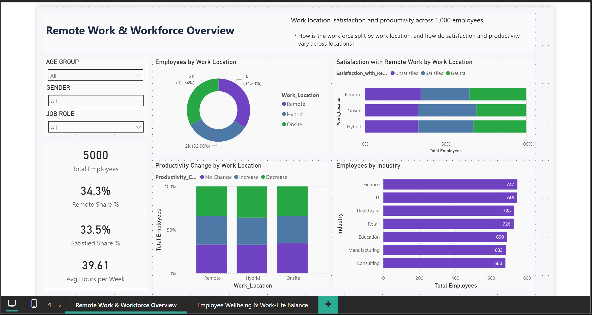

# Remote Work & Employee Wellbeing Analytics (Python EDA to Power BI)

Python exploratory analysis and a Power BI dashboard describing how work location, stress, sleep, work-life balance and company support vary across 5,000 employees. The Python exploration came first. The Power BI dashboard was built afterwards from a cleaned version of the same dataset.

> **Disclaimer:** The indicators are self-reported or dataset-provided. This is a descriptive analysis of one secondary-source dataset. It is not a clinical assessment, and it does not show that remote work causes any mental-health outcome.



## Business Problem

Organisations offering remote and hybrid work want to know whether work location is linked to employee satisfaction, stress, productivity, and work-life balance. Before making any decision, they need to know how large those differences are, and whether they are larger than the variation within each group.

## Objectives

1. Describe the workforce and its work arrangements.
2. Compare satisfaction, stress, productivity, and sleep across work locations and other groups.
3. Check whether the observed associations are larger than chance, using chi-square tests of independence.
4. Present the results in a Power BI dashboard that states clearly what the data does and does not show.

## Dataset

| Item | Detail |
|---|---|
| Source | Secondary source: Kaggle dataset "Remote Work and Mental Health", as linked in the original project README. Licence not verified. |
| Rows | 5,000 employees, no duplicate rows or IDs |
| Columns | 20 original: Age, Gender, Job_Role, Industry, Years_of_Experience, Work_Location, Hours_Worked_Per_Week, Number_of_Virtual_Meetings, Work_Life_Balance_Rating, Stress_Level, Mental_Health_Condition, Access_to_Mental_Health_Resources, Productivity_Change, Social_Isolation_Rating, Satisfaction_with_Remote_Work, Company_Support_for_Remote_Work, Physical_Activity, Sleep_Quality, Region |
| Missing values | Mental_Health_Condition: 1,196 blank (24%). Physical_Activity: 1,629 blank (33%). |

### Limitations

- **Category shares are almost uniform.** Most categories sit near one third of employees (for example, Work Location: 34.3%, 33.0%, 32.7%). Real survey data rarely looks like this. Treat the dataset as illustrative. Findings describe this file only.
- **Cross-sectional and self-reported.** There is no time dimension, so change over time cannot be assessed, and reporting is subjective.
- **Mental_Health_Condition is a categorical field** with values Anxiety, Burnout, and Depression, plus blanks. It is not a diagnosis and was not verified.
- **Productivity_Change is a three-level category** (Increase, No Change, Decrease). It is not a measured productivity value.
- **No causal design.** Associations are not evidence that remote work causes or prevents any outcome.

## Data Preparation

Performed in `scripts/prepare_and_compare.py`. The original file is kept unchanged in `data/raw/`.

- Checked for missing values, duplicate rows, and duplicate Employee IDs. None were duplicated.
- Kept blank values in Mental_Health_Condition and Physical_Activity, labelled them "Not reported", and did not drop rows.
- Added an ordinal Satisfaction_Score (Unsatisfied = 1, Neutral = 2, Satisfied = 3) for averages.
- Added bands: Age_Group (22-29, 30-39, 40-49, 50-60), Hours_Band (20-39, 40-49, 50-60), and Experience_Band (1-5, 6-10, 11-20, 21-35).

## Python EDA

The corrected notebook is in `notebook/` (see the corrections below). It covers data overview, missing values, descriptive statistics, distributions of age and job role, gender and industry, satisfaction by experience, work location against productivity change, work-life balance, mental-health and resource access, virtual meetings against satisfaction, physical activity against satisfaction, a correlation matrix, and a 3D view of age, hours, and satisfaction.

**Corrections made to the notebook (the analysis itself was not rewritten):**
- A cell overwrote the real data with a hand-typed 5-row sample. The plots that followed were drawn from that sample. The cell was removed, along with the template cells that followed it.
- The data path pointed to Kaggle. It now reads the file from the project folder.
- The 3D satisfaction plot failed on real data because satisfaction is text. It now uses the ordered 1 to 3 scale for plotting only.
- The figures in the last two plot cells were regenerated from the real data.

The notebook's "About Author" section, which credits the original Kaggle author, is unchanged.

## Key Findings

All figures come from `scripts/prepare_and_compare.py`. Results are descriptive, and associations are not causes.

- **Most groups look alike.** Satisfied 33.5%, high stress 33.7%, poor sleep 33.7%, productivity increase 31.7%. Across work locations, the shares for stress and productivity are within about two points of each other.
- **Satisfaction differs by work location, though the difference is small.** Remote workers are the least likely to report being satisfied (30.3%), compared with Hybrid (34.2%) and Onsite (36.2%). This is significant at p = 0.006 (chi-square, 4 degrees of freedom). It remains significant after a Bonferroni correction for the five tests run (0.006 is below 0.01).
- **Work location is not associated with stress or productivity change.** Stress by work location: p = 0.75. Productivity change by work location: p = 0.71.
- **Stress is not associated with satisfaction.** Chi-square p = 0.29.
- **Access to mental-health resources is not associated with the mental-health condition field.** Chi-square p = 0.37.
- **Hours worked are not related to work-life balance.** The correlation is 0.001. Average hours range only from 39.5 to 39.8 per week across work locations.
- **Work-life balance is almost flat across stress levels.** Averages are 3.03 (high stress), 3.00 (low), and 2.92 (medium), on a 1 to 5 scale. No test was run on this comparison.
- **Company support shows no consistent pattern.** Satisfied share ranges from 31.9% (support score 1) to 36.0% (score 5), with no steady trend in between. No test was run on this comparison.

**What these findings do not show:** They do not show that remote work causes lower satisfaction, higher stress, or any other outcome. The associations are small, the dataset is uniform across categories, and the analysis is cross-sectional. Further work would need real, observed data, a stronger design, and controls for role and workload.

## Dashboard

**Power BI file:** `dashboard/remote_work_wellbeing_dashboard.pbix` (to be built; see `docs/BUILD_GUIDE.md`)

| Page | Purpose | Key measures |
|---|---|---|
| Remote Work & Workforce Overview | Work-location split, satisfaction and productivity by location, industry mix | Total Employees, Remote Share %, Satisfied Share %, Avg Hours per Week |
| Employee Wellbeing & Work-Life Balance | Stress, sleep, work-life balance, company support, and the mental-health condition field | Avg Work-Life Balance, High Stress Share %, Poor Sleep Share %, Access to Resources %, Satisfied Share by Company Support |

## Tools and Techniques

- **Python:** pandas for cleaning, grouping, and bands; scipy for chi-square tests; seaborn and matplotlib for the EDA notebook.
- **Power BI:** data model, DAX measures, slicers, 100% stacked charts, a matrix, and a company-support column chart.

## Repository Structure

```
remote-work-wellbeing-analytics/
├── README.md
├── data/
│   ├── raw/
│   │   └── Impact_of_Remote_Work_on_Mental_Health.csv
│   └── cleaned_remote_work_wellbeing.csv
├── notebook/
│   └── remote-work-mental-health-eda.ipynb
├── scripts/
│   └── prepare_and_compare.py
├── dashboard/
│   └── remote_work_wellbeing_dashboard.pbix
├── dax/
│   └── measures.dax
├── docs/
│   ├── BUILD_GUIDE.md
│   └── CHANGE_LOG.md
└── screenshots/
    ├── 01_remote_work_overview.png
    └── 02_wellbeing_worklife.png
```

## How to View and Run

**Dashboard:** open `dashboard/remote_work_wellbeing_dashboard.pbix` in Power BI Desktop. If a file error appears, point the source to `data/cleaned_remote_work_wellbeing.csv` (Home > Transform data > Data source settings).

**Notebook:** open `notebook/remote-work-mental-health-eda.ipynb` in Jupyter. Run from the folder that contains `data/raw/`, or update the path in the first code cell.

**Data preparation and comparisons:**
```
pip install pandas scipy
python scripts/prepare_and_compare.py
```

## Disclaimer

This is a portfolio project using a secondary-source dataset. Results describe that dataset only. They are not clinical, do not identify causes, and should not be read as evidence about any real organisation.

## Author

**Sarthak Jaykar**

LinkedIn: https://www.linkedin.com/in/sarthak-jaykar

GitHub: https://github.com/sarthak-jaykar
